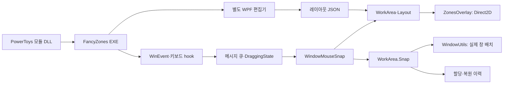

# FancyZones 소스 분석

분석일: 2026-10-31 KST. Microsoft PowerToys `8827f848fbbac4afeedcae2907c71cd05fd5aa86`의 소스를 읽었다. FancyZones를 빌드하거나 실행한 결과가 아니며 메모리·지연·성능은 측정하지 않았다.

로컬 참고 소스는 `.artifacts/references/PowerToys`에 있다. 아래 소스 링크는 분석한 커밋에 고정되어 있다. 이 문서의 실제 동작 설명과 마지막 절의 Waytoys 적용 제안을 구분한다.

## 1. 전체 구조와 실제 실행 경로

- 모듈 DLL은 Runner PID를 인자로 `PowerToys.FancyZones.exe`를 시작한다. EXE는 부모 프로세스 종료를 감시하고 메시지 루프를 돌린다. [모듈 시작](https://github.com/microsoft/PowerToys/blob/8827f848fbbac4afeedcae2907c71cd05fd5aa86/src/modules/fancyzones/FancyZonesModuleInterface/dllmain.cpp#L141), [EXE 진입점](https://github.com/microsoft/PowerToys/blob/8827f848fbbac4afeedcae2907c71cd05fd5aa86/src/modules/fancyzones/FancyZones/main.cpp#L63).
- 현재 빌드에서 창 드래그는 `WindowMouseSnap`을 사용한다. 파일로 남아 있는 `WindowDrag.cpp`를 현행 호출 흐름으로 설명하면 틀린다. [호출부](https://github.com/microsoft/PowerToys/blob/8827f848fbbac4afeedcae2907c71cd05fd5aa86/src/modules/fancyzones/FancyZonesLib/FancyZones.cpp#L510), [컴파일 대상](https://github.com/microsoft/PowerToys/blob/8827f848fbbac4afeedcae2907c71cd05fd5aa86/src/modules/fancyzones/FancyZonesLib/FancyZonesLib.vcxproj#L134).
- 편집기는 별도 WPF Windows 실행 파일이다. 드래그 중 그려지는 네이티브 오버레이와 편집기의 WPF 미리보기는 별개다. [편집기 프로젝트](https://github.com/microsoft/PowerToys/blob/8827f848fbbac4afeedcae2907c71cd05fd5aa86/src/modules/fancyzones/editor/FancyZonesEditor/FancyZonesEditor.csproj#L11), [편집기 Overlay](https://github.com/microsoft/PowerToys/blob/8827f848fbbac4afeedcae2907c71cd05fd5aa86/src/modules/fancyzones/editor/FancyZonesEditor/Overlay.cs#L138).

## 2. 창을 드래그해서 영역에 놓는 순서

1. `FancyZonesApp`이 키보드 및 WinEvent hook을 등록한다. 위치 변경 hook은 이동 시작 시 추가하고 종료 시 해제한다. [FancyZonesApp.cpp:76](https://github.com/microsoft/PowerToys/blob/8827f848fbbac4afeedcae2907c71cd05fd5aa86/src/modules/fancyzones/FancyZones/FancyZonesApp.cpp#L76).
2. 외부 이벤트를 `PostMessageW`로 내부 메시지 큐에 넘긴다. 이동 시작·위치 변경·종료를 한 흐름으로 처리하며 포인터 위치는 `GetPhysicalCursorPos`에서 얻는다. [메시지 전달](https://github.com/microsoft/PowerToys/blob/8827f848fbbac4afeedcae2907c71cd05fd5aa86/src/modules/fancyzones/FancyZonesLib/FancyZones.cpp#L281), [이벤트 처리](https://github.com/microsoft/PowerToys/blob/8827f848fbbac4afeedcae2907c71cd05fd5aa86/src/modules/fancyzones/FancyZonesLib/FancyZones.cpp#L940).
3. `DraggingState`가 Shift·Ctrl·마우스 버튼 토글을 관리한다. Shift를 요구하는 설정에서 활성화 조건은 Shift XOR 보조 버튼 토글이고, 다중 선택은 Ctrl OR 가운데 버튼 토글이다. 수정키 변화만으로도 현재 포인터 위치를 다시 평가한다. 따라서 포인터를 멈춘 채 Shift를 눌러도 동작한다. [활성화 규칙](https://github.com/microsoft/PowerToys/blob/8827f848fbbac4afeedcae2907c71cd05fd5aa86/src/modules/fancyzones/FancyZonesLib/DraggingState.cpp#L46), [다중 선택](https://github.com/microsoft/PowerToys/blob/8827f848fbbac4afeedcae2907c71cd05fd5aa86/src/modules/fancyzones/FancyZonesLib/DraggingState.cpp#L96), [수정키 재평가](https://github.com/microsoft/PowerToys/blob/8827f848fbbac4afeedcae2907c71cd05fd5aa86/src/modules/fancyzones/FancyZonesLib/FancyZones.cpp#L239).
4. `WindowMouseSnap`이 현재 모니터의 `WorkArea`를 선택하고 전역 포인터를 그 작업 영역의 내부 좌표로 변환한다. 모니터가 바뀌면 강조 상태를 초기화한다. snapping-mode 전환을 hit-test보다 먼저 수행한다. [WindowMouseSnap.cpp:74](https://github.com/microsoft/PowerToys/blob/8827f848fbbac4afeedcae2907c71cd05fd5aa86/src/modules/fancyzones/FancyZonesLib/WindowMouseSnap.cpp#L74).
5. `Layout::ZonesFromPoint`가 후보 영역을 찾고, `HighlightedZones`가 다중 선택 시 최초 영역과 현재 영역 사이의 결합 범위를 구한다. 단순히 지나간 영역을 모두 누적하는 방식은 아니다. [hit-test](https://github.com/microsoft/PowerToys/blob/8827f848fbbac4afeedcae2907c71cd05fd5aa86/src/modules/fancyzones/FancyZonesLib/Layout.cpp#L186), [강조 상태](https://github.com/microsoft/PowerToys/blob/8827f848fbbac4afeedcae2907c71cd05fd5aa86/src/modules/fancyzones/FancyZonesLib/HighlightedZones.cpp#L20).
6. 정상 드롭에서 `WorkArea::Snap`이 구역 인덱스 검증, 창 할당, 앱 이력 갱신, 결합 사각형 계산, 창 프레임 보정, 원래 geometry 저장, 실제 배치를 수행한다. [드롭](https://github.com/microsoft/PowerToys/blob/8827f848fbbac4afeedcae2907c71cd05fd5aa86/src/modules/fancyzones/FancyZonesLib/WindowMouseSnap.cpp#L118), [Snap](https://github.com/microsoft/PowerToys/blob/8827f848fbbac4afeedcae2907c71cd05fd5aa86/src/modules/fancyzones/FancyZonesLib/WorkArea.cpp#L127).

창 파괴나 작업 영역 재생성은 정상 드롭과 별개의 `AbortMoveSize` 경로다. 죽은 창을 배치하거나 해제된 WorkArea 포인터를 사용하지 않도록 표시 상태만 정리한다. [창 파괴 처리](https://github.com/microsoft/PowerToys/blob/8827f848fbbac4afeedcae2907c71cd05fd5aa86/src/modules/fancyzones/FancyZonesLib/FancyZones.cpp#L1018), [작업 영역 교체 전 취소](https://github.com/microsoft/PowerToys/blob/8827f848fbbac4afeedcae2907c71cd05fd5aa86/src/modules/fancyzones/FancyZonesLib/FancyZones.cpp#L1207), [Abort](https://github.com/microsoft/PowerToys/blob/8827f848fbbac4afeedcae2907c71cd05fd5aa86/src/modules/fancyzones/FancyZonesLib/WindowMouseSnap.cpp#L151).

키보드 이동도 최종적으로 같은 창 배치 경로를 사용한다. 인덱스 순서 이동과 공간적인 방향 이동은 별도 규칙이며, 설정에 따라 모니터를 넘어 이동한다. [WindowKeyboardSnap.cpp:13](https://github.com/microsoft/PowerToys/blob/8827f848fbbac4afeedcae2907c71cd05fd5aa86/src/modules/fancyzones/FancyZonesLib/WindowKeyboardSnap.cpp#L13).

## 3. 모니터별 오버레이와 좌표

### WorkArea가 표시와 배치의 경계다

일반 모드에서는 모니터별 작업 영역과 현재 가상 데스크톱을 기준으로 WorkArea를 만든다. `spanZonesAcrossMonitors` 설정을 켜면 결합 작업 영역 하나를 만드는 별도 경로가 있다. 여러 화면에 오버레이를 보여주는 설정과 여러 화면을 한 작업 영역으로 취급하는 설정은 서로 다르다. [UpdateWorkAreas](https://github.com/microsoft/PowerToys/blob/8827f848fbbac4afeedcae2907c71cd05fd5aa86/src/modules/fancyzones/FancyZonesLib/FancyZones.cpp#L1197).

각 WorkArea는 작업 영역 위치·크기의 투명 팝업 HWND와 `ZonesOverlay`를 갖는다. HWND는 풀에서 재사용하며, WorkArea를 파괴할 때 렌더러 스레드를 먼저 종료한 다음 HWND를 풀에 반환한다. [윈도 풀](https://github.com/microsoft/PowerToys/blob/8827f848fbbac4afeedcae2907c71cd05fd5aa86/src/modules/fancyzones/FancyZonesLib/WorkArea.cpp#L36), [생성·파괴 순서](https://github.com/microsoft/PowerToys/blob/8827f848fbbac4afeedcae2907c71cd05fd5aa86/src/modules/fancyzones/FancyZonesLib/WorkArea.cpp#L104), [오버레이 소유](https://github.com/microsoft/PowerToys/blob/8827f848fbbac4afeedcae2907c71cd05fd5aa86/src/modules/fancyzones/FancyZonesLib/WorkArea.cpp#L275).

오버레이는 바탕화면 스크린샷을 붙여 보여주는 구현이 아니다. Direct2D HWND render target에 영역 사각형·테두리·번호를 직접 그린다. 비강조 영역을 먼저, 강조 영역을 나중에 그린다. 표시 시에는 `SW_SHOWNA`를 사용하고 드래그 창을 기준으로 Z-order를 정한다. 여기서 표시된 코드를 근거로 모든 포인터 입력이 자동 통과된다고 주장할 수는 없다. [Direct2D 생성](https://github.com/microsoft/PowerToys/blob/8827f848fbbac4afeedcae2907c71cd05fd5aa86/src/modules/fancyzones/FancyZonesLib/ZonesOverlay.cpp#L191), [scene 구성](https://github.com/microsoft/PowerToys/blob/8827f848fbbac4afeedcae2907c71cd05fd5aa86/src/modules/fancyzones/FancyZonesLib/ZonesOverlay.cpp#L708), [표시](https://github.com/microsoft/PowerToys/blob/8827f848fbbac4afeedcae2907c71cd05fd5aa86/src/modules/fancyzones/FancyZonesLib/ZonesOverlay.cpp#L662), [Z-order](https://github.com/microsoft/PowerToys/blob/8827f848fbbac4afeedcae2907c71cd05fd5aa86/src/modules/fancyzones/FancyZonesLib/WorkArea.cpp#L396).

### 좌표 변환은 명시적인 단계다

- 입력: 전역 물리 포인터 → `MapWindowPoints` → 현재 WorkArea 내부 좌표 → 영역 hit-test.
- 배치: 작업 영역 내부의 결합 zone RECT → 창 프레임 여백·크기 제약 보정 → 화면 좌표 변환 → 작업 영역 좌표 보정 → `SetWindowPlacement`.
- Direct2D render target은 코드에서 DPI 96을 명시한다. 원본 주석도 DPI-aware 모드에서 이렇게 처리한다고 설명한다. 이 값이 Wayland 화면 배율 100%를 뜻하는 것은 아니다.
- 배치 대상 창의 DPI awareness, 모니터별 배율 차이, 작업 표시줄 위치를 보정하는 코드가 별도로 존재한다. 다른 모니터로 옮긴 뒤 Windows의 크기·배율 적용을 위해 `SetWindowPlacement`를 다시 호출한다.

[포인터 변환](https://github.com/microsoft/PowerToys/blob/8827f848fbbac4afeedcae2907c71cd05fd5aa86/src/modules/fancyzones/FancyZonesLib/WindowMouseSnap.cpp#L105), [프레임·화면 좌표 보정](https://github.com/microsoft/PowerToys/blob/8827f848fbbac4afeedcae2907c71cd05fd5aa86/src/modules/fancyzones/FancyZonesLib/WindowUtils.cpp#L364), [배치](https://github.com/microsoft/PowerToys/blob/8827f848fbbac4afeedcae2907c71cd05fd5aa86/src/modules/fancyzones/FancyZonesLib/WindowUtils.cpp#L213), [작업 영역 및 DPI awareness 보정](https://github.com/microsoft/PowerToys/blob/8827f848fbbac4afeedcae2907c71cd05fd5aa86/src/modules/fancyzones/FancyZonesLib/WindowUtils.cpp#L65).

### 렌더링 수명과 비용을 구분한다

각 ZonesOverlay가 자체 render thread를 만든다. 숨겨진 상태는 condition variable에서 기다리고, 표시 중에는 렌더링 루프를 돈다. `EndDraw()`가 수직 동기화를 기다릴 수 있어 그 전에 mutex를 풀도록 작성돼 있다. scene이 바뀔 때만 한 번 그리는 구현으로 설명하면 부정확하다. 이 구조만으로 소비 메모리나 CPU가 작다고 결론 내릴 수 없다. [Render/RenderLoop](https://github.com/microsoft/PowerToys/blob/8827f848fbbac4afeedcae2907c71cd05fd5aa86/src/modules/fancyzones/FancyZonesLib/ZonesOverlay.cpp#L617), [종료](https://github.com/microsoft/PowerToys/blob/8827f848fbbac4afeedcae2907c71cd05fd5aa86/src/modules/fancyzones/FancyZonesLib/ZonesOverlay.cpp#L839).

## 4. 레이아웃 엔진과 편집기·저장 모델

`Layout`은 Blank/Focus/Columns/Rows/Grid/PriorityGrid/Custom을 분기하고 `LayoutConfigurator`에 사각형 계산을 맡긴다. Grid는 전체 비율 10,000 및 셀→zone ID 매핑을 사용한다. Custom Canvas는 기준 작업 영역 크기와 X/Y/width/height를 저장하고 현재 작업 영역·DPI로 다시 계산한다. 결과는 작업 영역 내부의 zone ID별 사각형이다. [Layout 초기화](https://github.com/microsoft/PowerToys/blob/8827f848fbbac4afeedcae2907c71cd05fd5aa86/src/modules/fancyzones/FancyZonesLib/Layout.cpp#L109), [Grid 계산](https://github.com/microsoft/PowerToys/blob/8827f848fbbac4afeedcae2907c71cd05fd5aa86/src/modules/fancyzones/FancyZonesLib/LayoutConfigurator.cpp#L107), [Custom 계산](https://github.com/microsoft/PowerToys/blob/8827f848fbbac4afeedcae2907c71cd05fd5aa86/src/modules/fancyzones/FancyZonesLib/LayoutConfigurator.cpp#L400).

소스 주석과 분기가 어긋나는 부분도 있다. PriorityGrid 프리셋 주석은 11개 이하를 말하지만, 이 커밋의 실제 조건은 `zoneCount < predefinedLayoutsCount`다. 배열 길이가 11이므로 1–10개만 프리셋을 사용하고 11개부터 일반 Grid로 넘어간다. 이것은 정적 분기 확인이며 실행 시험은 하지 않았다. [실제 분기](https://github.com/microsoft/PowerToys/blob/8827f848fbbac4afeedcae2907c71cd05fd5aa86/src/modules/fancyzones/FancyZonesLib/LayoutConfigurator.cpp#L384).

저장은 다음 책임으로 분리된다.

- `custom-layouts.json`: UUID/name/type 및 Grid 또는 Canvas 형상 정의.
- `applied-layouts.json`: 모니터·가상 데스크톱별 적용 레이아웃과 설정. 대상이 아닌 기존 항목도 편집기가 보존한다.
- `default-layouts.json`: horizontal/vertical 구성별 기본 레이아웃.
- `app-zone-history.json`: 앱을 어느 device·layout UUID·zone 집합으로 복원할지에 대한 이력.
- `editor-parameters.json`: 편집기 시작 시 모니터 위치·크기·작업 영역·DPI·선택 상태를 전달하는 자료.

[저장 경로](https://github.com/microsoft/PowerToys/blob/8827f848fbbac4afeedcae2907c71cd05fd5aa86/src/modules/fancyzones/FancyZonesEditorCommon/Data/FancyZonesPaths.cs#L15), [Custom 구조](https://github.com/microsoft/PowerToys/blob/8827f848fbbac4afeedcae2907c71cd05fd5aa86/src/modules/fancyzones/FancyZonesEditorCommon/Data/CustomLayouts.cs#L23), [적용 구조](https://github.com/microsoft/PowerToys/blob/8827f848fbbac4afeedcae2907c71cd05fd5aa86/src/modules/fancyzones/FancyZonesEditorCommon/Data/AppliedLayouts.cs#L19), [앱 이력](https://github.com/microsoft/PowerToys/blob/8827f848fbbac4afeedcae2907c71cd05fd5aa86/src/modules/fancyzones/FancyZonesLib/FancyZonesData/AppZoneHistory.cpp#L161), [편집기 입출력](https://github.com/microsoft/PowerToys/blob/8827f848fbbac4afeedcae2907c71cd05fd5aa86/src/modules/fancyzones/editor/FancyZonesEditor/Utils/FancyZonesEditorIO.cs#L35).

현재 창의 zone 할당, 앱 재실행용 마지막 zone 이력, 원래 창 geometry는 다른 상태다. 원래 크기는 기존 restore property가 없을 때만 저장하여 영역 간 이동마다 덮어쓰지 않는다. [복원 geometry](https://github.com/microsoft/PowerToys/blob/8827f848fbbac4afeedcae2907c71cd05fd5aa86/src/modules/fancyzones/FancyZonesLib/WindowUtils.cpp#L276).

## 5. Waytoys 적용 제안

다음은 소스에서 얻은 설계 제안이며 아직 구현하거나 검증한 내용이 아니다.

1. **레이아웃 코어:** 작업 영역의 논리 크기·레이아웃 정의·간격을 입력받아 zone ID별 사각형을 산출한다. Grid 비율과 셀 병합, hit-test, 다중 영역 결합을 UI/OS와 분리한다.
2. **드래그 세션:** 시작·위치/수정키 변경·정상 드롭·취소를 명시한다. 수정키만 바뀌어도 재평가하고, 창 제거·출력 제거·레이아웃 교체는 commit 없이 종료한다.
3. **출력별 표시:** 출력 identity와 작업 영역 좌표를 유지한다. 현재 Waytoys의 출력별 layer surface 구조에 zone rectangles와 highlight 상태를 전달하는 방향으로 확장할 수 있다. Windows의 HWND/Direct2D/스레드 구성을 그대로 채택하는 결정은 별도다.
4. **KWin 통합:** 드래그 이벤트·수정키·실제 창 배치·복원을 담당하는 어댑터를 둔다. WinEvent/Win32 hook/SetWindowPlacement를 대체할 KDE 경로는 실제 세션에서 따로 검증한다. 오버레이 표시 성공만으로 이 통합이 완성된 것은 아니다.
5. **저장과 편집:** 형상 정의, 출력별 적용 상태, 앱 복원 이력, 원래 geometry를 분리한다. 편집기 UI는 이 모델을 편집하도록 구성한다.

먼저 검증할 한 사이클은 **기존 창 드래그 시작 → Shift 상태로 zone 표시 → 모니터 경계 이동 → 현재 zone 강조 → 정상 드롭 시 창 배치 → 취소 시 배치하지 않고 정리**다. 100%/115% 혼합 배율에서 전역 논리 좌표, 출력 내부 좌표, 렌더 버퍼 픽셀을 구분해 기록한다.

PowerToys 원본의 최상위 라이선스는 MIT다. 코드를 실제로 가져오는 경우 해당 파일·의존성의 라이선스와 저작권 고지를 함께 확인해야 한다. 이번 분석에서는 원본 코드를 Waytoys에 복사하지 않았다. [원본 LICENSE](https://github.com/microsoft/PowerToys/blob/8827f848fbbac4afeedcae2907c71cd05fd5aa86/LICENSE).
